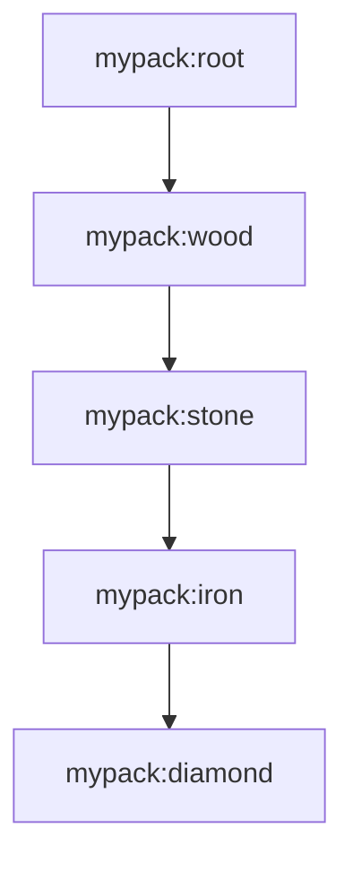

# Building advancement trees

This guide builds a small pack that hides the vanilla Story tab and replaces it
with a custom tree. The same pattern scales to multiple chapters.

## 1. Choose IDs and a layout

```text
mypack:root
mypack:wood
mypack:stone
mypack:iron
mypack:diamond
```



Use a namespace that belongs to your pack. Do not use `minecraft` unless you
intend to replace a vanilla ID.

## 2. Create the root

```lua
-- lua_scripts/startup/advancements.lua
advancement.add("mypack:root", {
  display = {
    icon = "minecraft:crafting_table",
    title = { text = "My Pack" },
    description = { text = "A new journey" },
    background = "minecraft:textures/gui/advancements/backgrounds/stone.png",
  },
  criteria = {
    tick = { trigger = "minecraft:tick" },
  },
})
```

Why `startup/`:

- The root should exist even after `/moontweaker reload`.
- Startup definitions are preserved across reloads.

The `minecraft:tick` criterion completes on the first tick, so the root is
immediately visible and acts as a tab.

### Background

`display.background` is a texture path under `assets/`:

```text
minecraft:textures/gui/advancements/backgrounds/stone.png
```

Common vanilla backgrounds:

```text
minecraft:textures/gui/advancements/backgrounds/stone.png
minecraft:textures/gui/advancements/backgrounds/nether.png
minecraft:textures/gui/advancements/backgrounds/end.png
```

A custom background must exist in a resource pack:

```text
assets/mypack/textures/gui/advancements/backgrounds/moon.png
```

```lua
background = "mypack:textures/gui/advancements/backgrounds/moon.png"
```

## 3. Add child advancements

```lua
advancement.add("mypack:wood", {
  parent = "mypack:root",
  display = {
    icon = "minecraft:oak_log",
    title = { text = "Lumberjack" },
    description = { text = "Get a log" },
    frame = "task",
  },
  criteria = {
    log = {
      trigger = "minecraft:inventory_changed",
      conditions = {
        items = {
          { item = "minecraft:log" },
        },
      },
    },
  },
})
```

The `parent` is the full ID, not a path relative to the current advancement.

### Criteria examples

Get an item:

```lua
criteria = {
  got = {
    trigger = "minecraft:inventory_changed",
    conditions = {
      items = {
        { item = "minecraft:iron_ingot", count = 1 },
      },
    },
  },
}
```

Kill an entity:

```lua
criteria = {
  kill = {
    trigger = "minecraft:player_killed_entity",
    conditions = {
      entity = {
        type = "minecraft:zombie",
      },
    },
  },
}
```

Visit a biome:

```lua
criteria = {
  visit = {
    trigger = "minecraft:location",
    conditions = {
      location = {
        biome = "minecraft:desert",
      },
    },
  },
}
```

Use a tick for a technical/immediate advancement:

```lua
criteria = {
  tick = { trigger = "minecraft:tick" },
}
```

### Frames

| Frame | Appearance |
|---|---|
| `task` | Square |
| `goal` | Rounded |
| `challenge` | Spiked |

```lua
display = { frame = "challenge", ... }
```

### Rewards

```lua
rewards = {
  experience = 100,
  recipes = { "minecraft:diamond_block" },
  loot = { "minecraft:chests/simple_dungeon" },
}
```

## 4. Replace the vanilla Story tab

```lua
advancement.removeVanillaTree("minecraft:story/root")
```

This tombstones the root and every descendant. The Story tab disappears.

If you want to replace the root itself:

```lua
advancement.removeVanillaTree("minecraft:story/root")
advancement.add("minecraft:story/root", {
  display = {
    icon = "minecraft:grass",
    title = { text = "Story" },
    description = { text = "A rewritten story" },
    background = "minecraft:textures/gui/advancements/backgrounds/stone.png",
  },
  criteria = {
    tick = { trigger = "minecraft:tick" },
  },
})
```

Custom definitions win over tombstones, so the root is visible again while the
original children stay hidden.

## 5. Replace all vanilla advancements

```lua
advancement.removeAllVanilla()
```

Then define your own tabs. Only `minecraft:*` IDs are hidden; modded
advancements are untouched.

## 6. Apply and test

On first install:

```text
start the game/server
```

On an existing world:

```text
/moontweaker reload
```

Advancements apply immediately on reload. Check:

```text
/moontweaker errors
```

Expected:

```text
No script errors
```

Then open the advancement screen. The new tab should appear, and the Story tab
should be gone.

## 7. Complete example

```lua
-- lua_scripts/startup/advancements.lua

advancement.removeVanillaTree("minecraft:story/root")

advancement.add("mypack:root", {
  display = {
    icon = "minecraft:crafting_table",
    title = { text = "My Pack" },
    description = { text = "A new journey" },
    background = "minecraft:textures/gui/advancements/backgrounds/stone.png",
  },
  criteria = {
    tick = { trigger = "minecraft:tick" },
  },
})

advancement.add("mypack:wood", {
  parent = "mypack:root",
  display = {
    icon = "minecraft:oak_log",
    title = { text = "Lumberjack" },
    description = { text = "Get a log" },
  },
  criteria = {
    log = {
      trigger = "minecraft:inventory_changed",
      conditions = {
        items = { { item = "minecraft:log" } },
      },
    },
  },
})

advancement.add("mypack:stone", {
  parent = "mypack:wood",
  display = {
    icon = "minecraft:cobblestone",
    title = { text = "Rock Bottom" },
    description = { text = "Get cobblestone" },
  },
  criteria = {
    cobble = {
      trigger = "minecraft:inventory_changed",
      conditions = {
        items = { { item = "minecraft:cobblestone" } },
      },
    },
  },
})

advancement.add("mypack:iron", {
  parent = "mypack:stone",
  display = {
    icon = "minecraft:iron_ingot",
    title = { text = "Iron Age" },
    description = { text = "Smelt iron" },
  },
  criteria = {
    iron = {
      trigger = "minecraft:inventory_changed",
      conditions = {
        items = { { item = "minecraft:iron_ingot" } },
      },
    },
  },
})

advancement.add("mypack:diamond", {
  parent = "mypack:iron",
  display = {
    icon = "minecraft:diamond",
    title = { text = "Shiny" },
    description = { text = "Get a diamond" },
    frame = "challenge",
  },
  criteria = {
    diamond = {
      trigger = "minecraft:inventory_changed",
      conditions = {
        items = { { item = "minecraft:diamond" } },
      },
    },
  },
  rewards = {
    experience = 100,
  },
})
```

## Common problems

| Symptom | Cause | Fix |
|---|---|---|
| Tab does not appear | Root has no `display.background` | Add a background |
| Advancement is invisible | Missing `display` | Add display or remove the definition |
| Parent warning | Parent ID typo or missing definition | Fix `parent` |
| Child appears at root | Parent failed to load | Check `/moontweaker errors` and the log |
| Vanilla tab still visible | Wrong root ID | Use `minecraft:story/root` exactly |
| Changes do not apply | Definition only in `startup/` and removed | Restart |
| Old definition remains | Removed from `startup/` | Restart |
| Client does not update | No player resync | `/moontweaker reload` triggers resync |

## Checking IDs

Use:

```text
/moontweaker dump items
/moontweaker dump blocks
/moontweaker dump recipes
/moontweaker dump ores
```

See [Finding IDs](/docs/guides/finding-ids).

## What comes next

[Finding IDs](/docs/guides/finding-ids) for registry and ore lookups.
