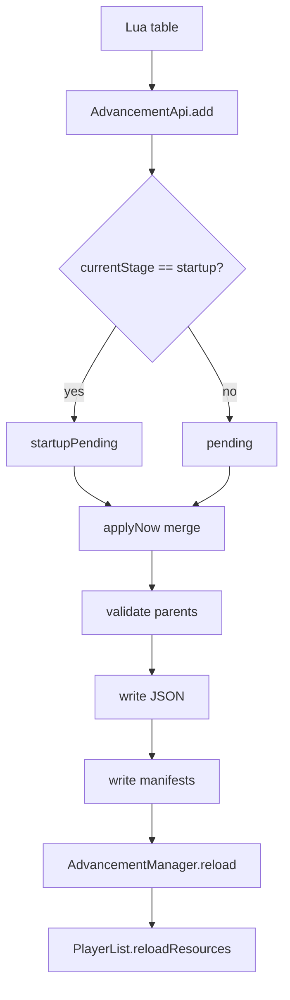

# Advancements

Advancements are the most complex subsystem in MoonTweaker because they are not
a Forge registry. They live in the world save, are loaded by
`AdvancementManager`, and are synced to clients by vanilla. MoonTweaker
generates the JSON files, reloads the manager and forces a player resync.

## Data flow



## Definition validation

```java
private static void add(String id, LuaValue def) {
    String checked = parseId(id);
    if (!def.istable()) {
        throw new LuaError("advancement.add(): expected definition table for '" + id + "'");
    }
    LuaValue display = def.get("display");
    if (display.istable()) {
        LuaValue icon = display.get("icon");
        if (icon.isstring()) {
            LuaValue iconObj = LuaValue.tableOf();
            iconObj.set("item", icon);
            display.set("icon", iconObj);
        }
    }
    JsonElement json = toJson(def);
    if (!json.isJsonObject()) {
        throw new LuaError("advancement.add(): definition must be a table");
    }
    try {
        AdvancementManager.GSON.fromJson(json, Advancement.Builder.class);
    } catch (Exception e) {
        throw new LuaError("advancement.add(): invalid definition for '"
            + checked + "': " + rootMessage(e));
    }
    Map<String, JsonObject> target = isStartupStage() ? startupPending : pending;
    target.put(checked, json.getAsJsonObject());
    removals.remove(checked);
    startupRemovals.remove(checked);
    vanillaRemovals.remove(checked);
    startupVanillaRemovals.remove(checked);
}
```

Validation uses vanilla's own deserializer. A definition that vanilla would
reject at world load is rejected immediately, with the root cause in the Lua
error. This catches missing criteria, malformed display objects and invalid
triggers.

The `display.icon` shorthand:

```lua
display = { icon = "minecraft:diamond" }
```

is rewritten to:

```json
"display": { "icon": { "item": "minecraft:diamond" } }
```

If `icon` is already a table (`{ item = "...", data = 0 }`), it is left alone.

## Lua-to-JSON conversion

`toJson` handles:

| Lua type | JSON |
|---|---|
| `nil` | `null` |
| boolean | boolean |
| number, integral | integer (`long`) |
| number, fractional | double |
| string | string |
| table, array-like | array |
| table, keyed | object |

A table is treated as an array only when **every** key is an integer and the
maximum key equals the number of keys. Otherwise it becomes an object with
`key.tojstring()` keys.

```lua
{ "a", "b" }                 -- ["a", "b"]
{ [1] = "a", [3] = "c" }     -- { "1": "a", "3": "c" }
{ name = "x" }               -- { "name": "x" }
```

An empty table becomes an object (`{}`), not an array. This matters for
`requirements`, `rewards.recipes` and similar arrays: an empty Lua table is
serialized as `{}`, which vanilla may reject or interpret differently. Omit the
field instead of passing an empty table.

## Definition shape

MoonTweaker does not invent a schema; it accepts the vanilla 1.12.2 advancement
JSON shape:

```lua
advancement.add("mypack:root", {
  display = {
    icon = "minecraft:crafting_table",
    title = { text = "My Pack" },
    description = { text = "A new tree" },
    background = "minecraft:textures/gui/advancements/backgrounds/stone.png",
    frame = "task",
    show_toast = true,
    announce_to_chat = true,
    hidden = false,
  },
  criteria = {
    tick = { trigger = "minecraft:tick" },
  },
  requirements = {
    { "tick" },
  },
})
```

| Field | Required | Notes |
|---|---|---|
| `display` | For visible advancements | Omit for invisible technical advancements |
| `display.icon` | Yes for display | String shorthand or `{ item, data }` |
| `display.title` | Yes for display | Text component (`{ text = ... }` or `{ translate = ... }`) |
| `display.description` | Yes for display | Text component |
| `display.background` | Root only | Texture path; required for a tab background |
| `display.frame` | No | `task`, `goal`, `challenge` |
| `display.show_toast` | No | Default true |
| `display.announce_to_chat` | No | Default true |
| `display.hidden` | No | Default false |
| `parent` | No | Full advancement ID; omit for a root |
| `criteria` | Yes | Map of criterion name to trigger object |
| `requirements` | No | Array of arrays of criterion names |
| `rewards` | No | `experience`, `recipes`, `loot`, `function` |

### Criteria

Vanilla triggers are strings under `trigger`:

```lua
criteria = {
  got_diamond = {
    trigger = "minecraft:inventory_changed",
    conditions = {
      items = {
        { item = "minecraft:diamond", count = 1 },
      },
    },
  },
}
```

MoonTweaker passes the table through unchanged. Any trigger that vanilla
supports works, including modded triggers registered by other mods, as long as
the advancement JSON references them by ID.

### Requirements

`requirements` controls which criteria must be satisfied:

```lua
criteria = {
  a = { trigger = "minecraft:tick" },
  b = { trigger = "minecraft:tick" },
},
requirements = {
  { "a", "b" },   -- both required
}
```

Omit it to use vanilla's default (all criteria in one group).

### Parent

`parent` must be a full ID:

```lua
parent = "mypack:root"
```

A parent can be:
- another advancement in the same apply;
- an advancement already loaded by vanilla or another mod;
- a tombstoned advancement (it still exists, invisible).

If the parent is neither pending nor loaded, `applyNow` logs a warning. Vanilla
may still load the child, but it can end up disconnected.

## Custom IDs and files

`parseId` uses `ResourceLocation`:

```java
ResourceLocation rl = new ResourceLocation(id);
if (rl.getPath().isEmpty()) throw new LuaError("bad advancement id '" + id + "'");
return rl.toString();
```

- IDs must be `namespace:path`.
- The namespace defaults to `minecraft` if omitted by `ResourceLocation`, so
  always write both parts.
- The file path is:

```text
<world>/data/advancements/<namespace>/<path>.json
```

- Nested paths (`mypack:chapter/quest1`) create subdirectories.
- The JSON is pretty-printed with Gson.
- Existing bytes are compared before writing; unchanged definitions are not
  rewritten.

## Tombstones

A tombstone hides an advancement that comes from vanilla or another mod. It is
a valid advancement with the same ID:

```json
{
  "parent": "minecraft:story/root",
  "criteria": {
    "moontweaker_removed": {
      "trigger": "minecraft:impossible"
    }
  }
}
```

Why it works:

- `AdvancementManager` loads files by ID; the generated file wins over the
  original resource.
- No `display` means no GUI entry and no tab.
- `minecraft:impossible` can never be triggered, so it cannot complete.
- Keeping the original `parent` prevents the node from becoming a new invisible
  root. Visible descendants attach to the nearest visible ancestor.

The parent is copied from the currently loaded advancement:

```java
if (existing != null && existing.getParent() != null) {
    root.addProperty("parent", existing.getParent().getId().toString());
}
```

If the advancement is not loaded, it cannot be tombstoned and a warning is
logged.

### Removing one advancement

```lua
advancement.removeVanillaAdvancement("minecraft:story/mine_stone")
```

### Removing a whole tree

```lua
advancement.removeVanillaTree("minecraft:story/root")
```

`collectTree` walks `advancement.getChildren()` recursively and adds every
descendant. Custom pending definitions are excluded, so a pack can replace
individual nodes.

### Removing all vanilla

```lua
advancement.removeAllVanilla()
```

At apply time, every loaded advancement in the `minecraft` namespace is
tombstoned, except IDs that have a custom pending definition. Modded namespaces
are untouched.

### Custom wins

`collectVanillaTargets` ends with:

```java
targets.removeAll(pending.keySet());
```

A custom definition with the same ID as a tombstone target is written instead of
a tombstone. This is how a pack replaces a vanilla tree root with its own.

## Manifests

Two files in `<world>/data/advancements/` track what MoonTweaker owns:

| File | Contents |
|---|---|
| `.moontweaker` | IDs of generated custom advancements |
| `.moontweaker-vanilla` | IDs of generated tombstones |

On each apply:

1. Read both manifests.
2. Delete files for IDs that are no longer pending or no longer targeted.
3. Write current definitions and tombstones.
4. Rewrite both manifests.

This cleanup is why removing a Lua definition also removes its JSON file on the
next apply. Without manifests, MoonTweaker could not distinguish its own files
from files owned by other mods or data packs.

Do not edit these files by hand. If they are deleted, MoonTweaker loses track
of old files and will not clean them up; the advancements may remain active
until the files are removed manually.

## Apply algorithm

```java
Map<String, JsonObject> mergedPending = new LinkedHashMap<>(startupPending);
mergedPending.putAll(pending);                    // server wins
Set<String> mergedRemovals = startupRemovals + removals;
for (String id : mergedRemovals) mergedPending.remove(id);
warnMissingParents(server, mergedPending);
...
int changed = 0;
for (String id : mergedRemovals) changed += deleteFile(advDir, id);
for (String id : previous) {
    if (!mergedPending.containsKey(id)) changed += deleteFile(advDir, id);
}
for (String id : previousVanilla) {
    if (!vanillaTargets.contains(id) && !mergedPending.containsKey(id)) {
        changed += deleteFile(advDir, id);
    }
}
for (entry : mergedPending) changed += writeJson(...);
for (String id : vanillaTargets) {
    if (!mergedPending.containsKey(id)) changed += writeJson(advDir, id, tombstone(...));
}
writeManifest(...);
if (changed > 0 || !previous.isEmpty() || !previousVanilla.isEmpty()) {
    manager.reload();
    if (manager.hasErrored()) warn;
    server.getPlayerList().reloadResources();
    log applied/hid counts;
}
```

Important properties:

- **Startup definitions survive a reload** because they are merged from
  `startupPending` on every apply.
- **Server definitions override startup definitions** with the same ID.
- **Removals win over definitions** in the same merged view.
- **Tombstones are generated from the currently loaded manager**, so an
  advancement added by another mod after startup may not be known yet.
- **No changes, no reload.** A pack with only recipe changes does no
  advancement work.
- **The entire apply is one try/catch.** An exception logs
  `failed to apply advancements` and leaves the pending maps intact for the
  next attempt.

## Parent warnings

```java
for (entry : pending) {
    if (!json.has("parent")) continue;
    String parent = json.get("parent").getAsString();
    if (pending.containsKey(parent)) continue;
    if (manager.getAdvancement(new ResourceLocation(parent)) != null) continue;
    logger.warn("MoonTweaker: advancement '{}' references missing parent '{}'", ...);
}
```

The warning is advisory. Vanilla may still load the child as a root or drop it,
depending on the parent reference.

## Reload behaviour

`/moontweaker reload`:

1. `AdvancementApi.reset()` clears `pending`, `removals`, `vanillaRemovals`,
   `vanillaTreeRemovals` and `allVanillaRemoved`.
2. It does **not** clear `startupPending`, `startupRemovals`,
   `startupVanillaRemovals`, `startupVanillaTreeRemovals` or
   `startupAllVanillaRemoved`.
3. `server/` re-queues its definitions.
4. The command calls `AdvancementApi.apply(server, LOGGER)`.
5. Files are rewritten as needed, the manager reloads and players resync.

Consequences:

- A definition that exists only in `startup/` remains active across reloads.
- A definition removed from `server/` is deleted on the next reload (the
  manifest no longer lists it).
- A definition removed from `startup/` is **not** deleted by a reload, because
  the startup map still contains it until restart. It is deleted on the next
  game start when startup runs again without it.
- A tombstone removed from `startup/` likewise remains until restart.

## Threading and player sync

```java
public static void apply(MinecraftServer server, Logger logger) {
    Runnable task = () -> applyNow(server, logger);
    if (server.isCallingFromMinecraftThread()) task.run();
    else server.addScheduledTask(task);
}
```

After a reload that changes files:

```java
server.getAdvancementManager().reload();
if (server.getPlayerList() != null) {
    server.getPlayerList().reloadResources();
}
```

`PlayerList.reloadResources()` calls `PlayerAdvancements.reload()` for every
online player, rebuilding criterion listeners and resyncing the tree. Without
it, clients keep the old advancement screen until reconnect.

## Failure modes

| Situation | Result |
|---|---|
| Invalid ID | `bad advancement id '<id>'` |
| Definition not a table | `advancement.add(): expected definition table for '<id>'` |
| Vanilla validation fails | `advancement.add(): invalid definition for '<id>': <cause>` |
| Missing parent | Warning; file still written |
| Remove non-existent advancement | Warning; skipped |
| Remove non-existent tree | Warning; skipped |
| Disk write fails | Whole apply fails, logged |
| Manager reload errors | Warning, `hasErrored()` |
| No server (apply before start) | Not called in normal flow |

## What comes next

[Loot](/docs/internals/loot) covers the other reflection-heavy subsystem.
