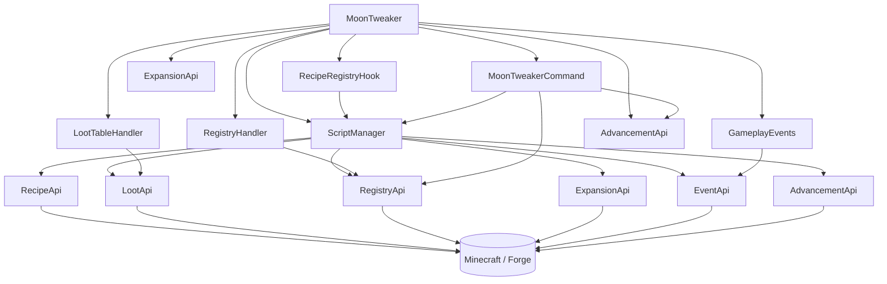
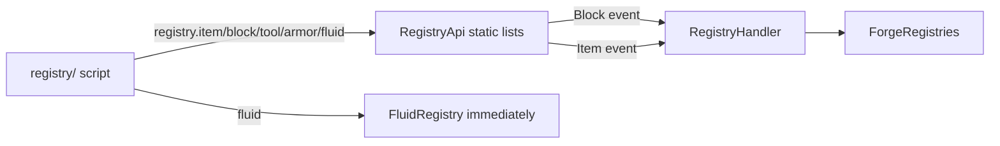
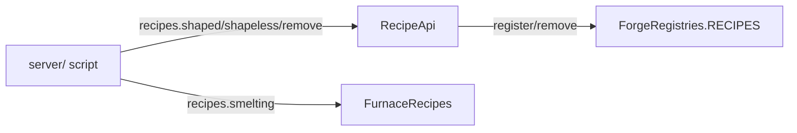
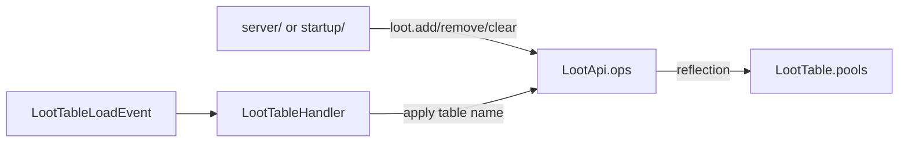
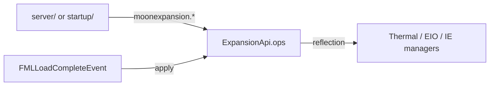
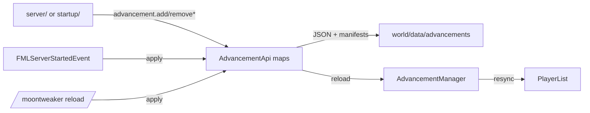

# Architecture

MoonTweaker is a small Java mod: 14 classes, no Mixins, no coremod, no
transformed Minecraft classes. It uses Forge's public APIs, plus narrow
reflection where Forge exposes no mutation API.

## Package map

```text
com.moontweaker
├── MoonTweaker.java              @Mod entry point, event handlers
├── api/
│   └── MoonTweakerApi.java       currentStage string
├── script/
│   └── ScriptManager.java        discovery, Globals, require, errors, reload
├── lua/
│   └── RecipeApi.java            item(), ore(), recipes.*
├── loot/
│   ├── LootApi.java              loot.* queue, pool mutation, reflection
│   └── LootTableHandler.java     LootTableLoadEvent subscriber
├── registry/
│   ├── RegistryApi.java          registry.* bindings and pending objects
│   └── RegistryHandler.java      Block/Item registry event subscriber
├── expansion/
│   └── ExpansionApi.java         moonexpansion.* queue and reflection
├── event/
│   ├── EventApi.java             listener registry, context, emit
│   ├── GameplayEvents.java       Forge gameplay event subscribers
│   └── RecipeRegistryHook.java   loads server/ at LOWEST
├── advancement/
│   └── AdvancementApi.java       Lua definitions, tombstones, manifests
└── command/
    └── MoonTweakerCommand.java   /moontweaker reload|errors|dump
```

## Class responsibilities

| Class | Responsibility | State |
|---|---|---|
| `MoonTweaker` | `@Mod` declaration; wires handlers; calls stage loaders | `LOGGER`, `SCRIPTS` |
| `MoonTweakerApi` | Holds the current stage string for gated APIs | `currentStage` |
| `ScriptManager` | Stage loading, file discovery, `Globals`, `require`, errors | errors, modules, counters |
| `RecipeApi` | Item parsing and recipe add/remove | none (uses `ScriptManager` for IDs) |
| `LootApi` | Loot operation queue and table mutation | ops, pool counter, reflection fields |
| `LootTableHandler` | Applies queued loot on table load | logger |
| `RegistryApi` | Content queue, namespace, materials | namespace, IDs, item/block lists, material maps |
| `RegistryHandler` | Registers queued blocks and items | logger |
| `ExpansionApi` | Machine recipe queue and reflective application | ops, `applied` |
| `EventApi` | Lua listener map and dispatch | listeners, logger |
| `GameplayEvents` | Translates Forge events into `EventApi.emit` | none |
| `RecipeRegistryHook` | Runs `server/` during the recipe event | `ScriptManager` |
| `AdvancementApi` | JSON generation, tombstones, manifests, apply | pending maps, removal sets, flags |
| `MoonTweakerCommand` | Reload, errors, registry dumps | `ScriptManager` |

## Dependency graph



Every arrow points from a caller to a callee. The APIs themselves depend only
on Minecraft/Forge and LuaJ; there are no cycles between MoonTweaker packages.

## Initialization wiring

```java
@Mod(...)
public class MoonTweaker {
    public static final Logger LOGGER = LogManager.getLogger(MODID);
    public static final ScriptManager SCRIPTS = new ScriptManager(LOGGER);

    @Mod.EventHandler
    public void preInit(FMLPreInitializationEvent event) {
        SCRIPTS.loadRegistry();
        MinecraftForge.EVENT_BUS.register(new RegistryHandler(LOGGER));
        MinecraftForge.EVENT_BUS.register(new LootTableHandler(LOGGER));
        MinecraftForge.EVENT_BUS.register(new RecipeRegistryHook(SCRIPTS));
        MinecraftForge.EVENT_BUS.register(new GameplayEvents());
    }

    @Mod.EventHandler
    public void postInit(FMLPostInitializationEvent event) {
        SCRIPTS.loadStartup();
    }

    @Mod.EventHandler
    public void loadComplete(FMLLoadCompleteEvent event) {
        ExpansionApi.apply(LOGGER);
    }

    @Mod.EventHandler
    public void serverStarting(FMLServerStartingEvent event) {
        event.registerServerCommand(new MoonTweakerCommand(SCRIPTS));
    }

    @Mod.EventHandler
    public void serverStarted(FMLServerStartedEvent event) {
        AdvancementApi.apply(
            FMLCommonHandler.instance().getMinecraftServerInstance(),
            LOGGER
        );
    }
}
```

All four event-bus subscribers are registered in `preInit`, before Forge fires
the block/item registry events. `RecipeRegistryHook` survives until
`initializeMods`, `LootTableHandler` until runtime, and `GameplayEvents` for the
process lifetime.

## Design decisions

### No Mixins or coremod

MoonTweaker does not patch classes. Everything goes through:

- Forge registries (`ForgeRegistries`, `FluidRegistry`, `FurnaceRecipes`).
- Forge events (`RegistryEvent`, `LootTableLoadEvent`, gameplay events).
- Vanilla APIs (`AdvancementManager`, `PlayerList`).

This keeps the mod compatible with other mods and avoids mapping fragility.
The cost is that some operations are impossible without reflection.

### Narrow reflection

Reflection is used only where Forge has no public mutation API:

| Area | Reason |
|---|---|
| Loot pools/entries | `LootTable.pools` and `LootPool.lootEntries` are private |
| Machine managers | Thermal Expansion, Ender IO and IE expose static managers with version-specific overloads |

Every reflective access has a fallback:

- Loot fields try the deobfuscated name, then the SRG name.
- Machine methods are found by name and parameter count, not exact signature.

### Static API state

Most APIs keep state in `static` fields. This is deliberate: Lua has no object
handle to the API, and Forge events are delivered to a single subscriber
instance. The trade-off is that state is process-global and must be reset
explicitly at stage boundaries. The reset matrix is documented in
[State, resets and reload](/docs/internals/mod-init/state-and-reload).

### Per-file failure

`ScriptManager.runFile` catches `LuaError` and any `Throwable` per file. A
broken file is recorded and skipped; the rest of the stage continues. This is
why `/moontweaker errors` exists: the stage summary only reports a count.

### Stage gating

Only two APIs are explicitly gated:

- `RegistryApi.install` installs a restricted table outside `registry/`.
- `ExpansionApi` rejects calls from `registry/` and after `applied`.

Everything else relies on timing: recipes fail when the registry is frozen,
loot is discarded if reset later, advancements are ignored if queued in the
wrong map. This is intentional: error messages are better than silent
no-ops only where the mistake is common.

## Data flow

### Registry content



### Recipes



### Loot



### Machines



### Advancements



## Threading

| Phase | Thread |
|---|---|
| Mod construction, pre-init, recipe event, post-init, load complete | Mod loading thread |
| Server starting/started | Server thread |
| Commands | Server thread |
| Loot table load | Server thread |
| Gameplay events, ticks | Server thread |

`AdvancementApi.apply` is the only API that checks the thread and schedules
itself with `server.addScheduledTask` when needed. Everything else assumes the
caller is already on the right thread.

## Failure containment

| Failure | Contained by |
|---|---|
| Lua syntax/runtime error | `runFile` try/catch, per file |
| Event callback error | `EventApi.emit` try/catch, per listener |
| Loot operation error | `LootApi.apply` try/catch, per operation |
| Machine recipe error | `ExpansionApi.apply` try/catch, per operation |
| Advancement error | `applyNow` try/catch, whole apply |
| Registry reflection field missing | static initializer `ExceptionInInitializerError` |

The last one is not contained: if the loot field names do not resolve, the
class fails to initialize and the loot API is unusable. This is the most
mapping-sensitive code path.

## Extension points

To add a new Lua API:

1. Create a class with `install(Globals g, ...)`.
2. Build a `LuaValue` table and bind functions.
3. Call it from `ScriptManager.createGlobals`.
4. If the API needs a Forge event, add a subscriber in `MoonTweaker.preInit`.
5. If the API queues work for later, add a reset in the appropriate stage and
   an apply call at the right lifecycle event.
6. Document it in the [API reference](/docs/api/data-types).

See [Extending](/docs/development/extending) for a walkthrough.

## What comes next

- [Advancements](/docs/internals/advancements) — the most complex subsystem.
- [Loot](/docs/internals/loot) — reflective table mutation.
- [Registry](/docs/internals/registry) — content creation and materials.
- [Machines](/docs/internals/machines) — version-tolerant reflection.
