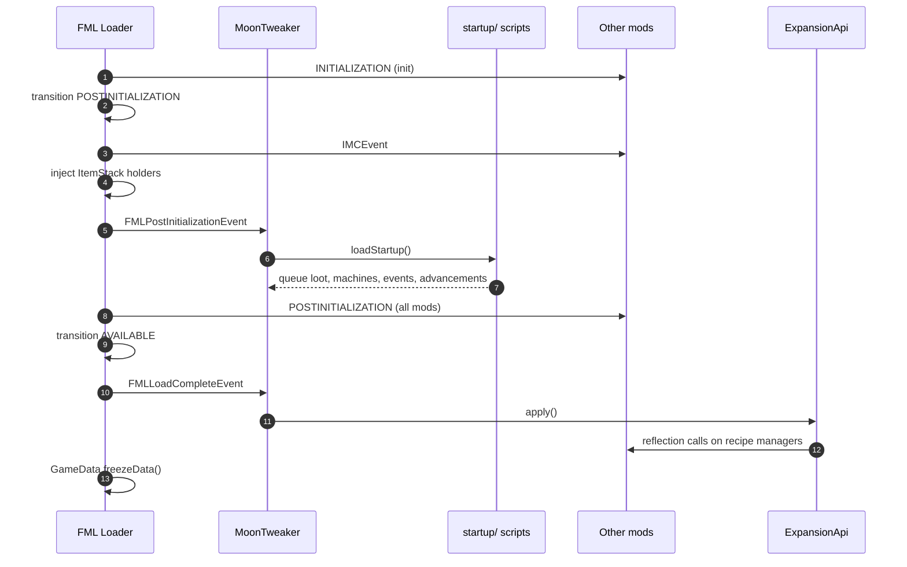

# Post-initialization and load complete

After the recipe event returns, Forge finishes `Loader.initializeMods()`:

```java
CraftingHelper.loadRecipes(false);
modController.distributeStateMessage(LoaderState.INITIALIZATION);
modController.transition(LoaderState.POSTINITIALIZATION, false);
modController.distributeStateMessage(FMLInterModComms.IMCEvent.class);
ItemStackHolderInjector.INSTANCE.inject();
modController.distributeStateMessage(LoaderState.POSTINITIALIZATION);
modController.transition(LoaderState.AVAILABLE, false);
modController.distributeStateMessage(LoaderState.AVAILABLE);
GameData.freezeData();
```

`FMLPostInitializationEvent` is the `POSTINITIALIZATION` dispatch, and
`FMLLoadCompleteEvent` corresponds to `ModState.AVAILABLE`.



## Why `startup/` exists

`server/` is enough for recipes, but some work should **not** be wiped by
`/moontweaker reload`:

- A base advancement tree that should survive reloads.
- Loot operations that must exist regardless of later `server/` edits.
- Machine recipes defined once for the world.

`startup/` runs later than `server/` and is never re-run by the reload command.
Its queued state is kept in separate fields for advancements, while other APIs
share the same queues.

`startup/` also runs after every mod's `init` handler, so mod content that is
created during initialization (not pre-init) exists by then.

## What `loadStartup()` does

```java
public void loadStartup() {
    load("startup");
}
```

Unlike `registry` and `server`, the `switch` in `load()` has no `startup` case.
Nothing is reset. The consequences are important:

| State | Effect of loading `startup/` |
|---|---|
| `require` module cache | Cleared before the stage |
| Lua globals | Fresh `Globals` |
| `EventApi` listeners from `server/` | **Kept** |
| `LootApi` operations from `server/` | **Kept and appended** |
| `ExpansionApi` operations from `server/` | **Kept and appended** |
| `AdvancementApi` server queue | Kept; startup definitions go to `startupPending` |
| Recipe counter | Not reset (irrelevant: registry is frozen) |

So `server/` and `startup/` share one Lua-independent state. A listener
registered in `server/` and another registered in `startup/` both fire.

### `startup/` and recipes

`recipes` is installed in every stage. In `startup/` the registry is already
frozen, so:

- `recipes.shaped` / `recipes.shapeless` throw a Forge
  `IllegalStateException`.
- `recipes.remove` cannot remove anything.
- `recipes.smelting` **can** still mutate `FurnaceRecipes`, because that map is
  not frozen by Forge. It is not recommended, because the change is invisible
  to `recipes.remove` and to JEI.

Use `server/` for recipes.

## Machine recipes at `FMLLoadCompleteEvent`

`ExpansionApi` does not touch Thermal Expansion, Ender IO or Immersive
Engineering while scripts run. Calls validate arguments and append an `Op` to a
list:

```java
private static final List<Op> ops = new ArrayList<>();
private static boolean applied = false;

public static void apply(Logger logger) {
    if (ops.isEmpty()) {
        applied = true;
        return;
    }
    int count = 0;
    for (Op op : ops) {
        try {
            op.action.run();
            count++;
        } catch (Throwable e) {
            logger.error("MoonTweaker: failed to add {}: {}", op.description, rootMessage(e));
        }
    }
    ops.clear();
    applied = true;
    logger.info("MoonTweaker: applied {} machine recipes", count);
}
```

The mod calls `ExpansionApi.apply(LOGGER)` from `loadComplete`:

```java
@Mod.EventHandler
public void loadComplete(FMLLoadCompleteEvent event) {
    ExpansionApi.apply(LOGGER);
}
```

### Why not earlier?

Thermal Expansion, Ender IO and Immersive Engineering register their own recipe
managers during their `init` and `postInit` handlers. Adding recipes during
`server/` (which runs before `init`) would either fail or be overwritten when
the mod populates its manager. `AVAILABLE` is the first moment every mod has
finished initialization.

### Why not later?

`GameData.freezeData()` runs immediately after the `AVAILABLE` dispatch. While
that freezes Forge registries, the machine managers are ordinary mod objects
and are not frozen by it. Waiting until server start would also work, but
`FMLLoadCompleteEvent` is the conventional point and keeps machine recipes
available to the first world load.

### Failure isolation

Each `Op` runs in its own `try` block. A missing class, changed overload or
duplicate input logs:

```text
MoonTweaker: failed to add thermal pulverizer minecraft:apple: <message>
```

and the remaining operations still run. The final count only includes
successful operations.

### The `applied` flag

After `apply()`, `applied` is `true`. Any later `moonexpansion.*` call throws:

```text
moonexpansion: machine recipes are applied at startup; restart the game
```

`/moontweaker reload` calls `ExpansionApi.reset()`, which clears `ops` **and
sets `applied = false`**. This produces a subtle state:

1. Reload clears machine operations queued at startup.
2. Server scripts run again and can queue machine recipes without error.
3. `apply()` is not called again until the next game start, so those queued
   operations are never applied.

The practical rule is unchanged: **machine recipes require a restart.**
Reloading server scripts is not a way to change them. The error message that
would normally guard against this is absent after a reload because the reset
clears the flag; the operations simply sit in the queue.

## `startup/` versus `server/` for machines

Both stages append to the same `ops` list, and both run before
`FMLLoadCompleteEvent`. There is no functional difference for machine recipes.
Choose `startup/` if the definition should survive a reload without being
re-queued; choose `server/` if you edit it often and restart anyway.

## Logs at this point

```text
MoonTweaker: stage 'startup' loaded, 2 scripts, 0 errors
MoonTweaker: applied 9 machine recipes
```

If no machine recipes were queued, `apply()` returns silently. There is no
`applied 0 machine recipes` line in that case.

## What comes next

`GameData.freezeData()` completes mod loading. When a world is opened, Forge
calls `serverStarting` and then `serverStarted`. MoonTweaker registers its
command at the first and applies advancements at the second. Continue with
[Server lifecycle](/docs/internals/mod-init/server-lifecycle).
