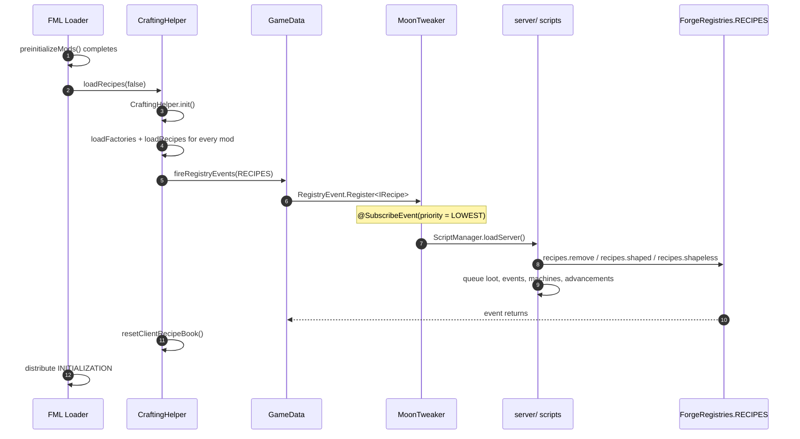

# Recipe registration

`server/` is the stage you will use most, and its timing is the least obvious.
It does not run at pre-initialization or post-initialization: it runs **inside
the recipe registry event**, during `Loader.initializeMods()`.

## Where the recipe event comes from

In Forge 1.12.2, `Loader.preinitializeMods()` deliberately excludes recipes:

```java
GameData.fireRegistryEvents(rl -> !rl.equals(GameData.RECIPES));
```

Recipes are fired later, by `CraftingHelper.loadRecipes()`:

```java
public static void loadRecipes(boolean revertFrozen) {
    init();
    ForgeRegistry<IRecipe> reg = (ForgeRegistry<IRecipe>) ForgeRegistries.RECIPES;
    if (DEBUG_LOAD_MINECRAFT) reg.clear();
    else if (revertFrozen) GameData.revert(RegistryManager.FROZEN, GameData.RECIPES, false);

    Loader.instance().setActiveModContainer(null);
    Loader.instance().getActiveModList().forEach(CraftingHelper::loadFactories);
    Loader.instance().getActiveModList().forEach(CraftingHelper::loadRecipes);
    Loader.instance().setActiveModContainer(null);

    GameData.fireRegistryEvents(rl -> rl.equals(GameData.RECIPES));

    FMLCommonHandler.instance().resetClientRecipeBook();
}
```

And `Loader.initializeMods()` calls it **before** the `INITIALIZATION` state
message, i.e. before any mod's `init` handler:

```java
public void initializeMods() {
    progressBar.step("Initializing mods Phase 2");
    CraftingHelper.loadRecipes(false);
    modController.distributeStateMessage(LoaderState.INITIALIZATION);
    ...
}
```

The full order around this point is:



## The hook

```java
public class RecipeRegistryHook {
    private final ScriptManager scripts;

    @SubscribeEvent(priority = EventPriority.LOWEST)
    public void onRegisterRecipes(RegistryEvent.Register<IRecipe> event) {
        scripts.loadServer();
    }
}
```

Two properties matter:

1. **It runs during the event.** The recipe registry is still mutable. MoonTweaker
   can add and remove entries through `ForgeRegistries.RECIPES`.
2. **`LOWEST` priority.** Forge dispatches listeners from highest to lowest
   priority. Every mod that registers recipes at `NORMAL` or higher has already
   run, so `recipes.remove("othermod:thing")` can see those recipes.

Without `LOWEST`, MoonTweaker would load before other mods and could only
remove vanilla recipes. This is the entire reason the hook exists as a separate
class.

:::warning Do not change the priority
`HIGHEST` would break removal of modded recipes. `LOWEST` is the last chance to
touch the registry before Forge freezes it.
:::

## What `loadServer()` does

`ScriptManager.load("server")` follows the common stage sequence, with one
extra block of resets:

```java
case "server":
    EventApi.clear();
    LootApi.reset();
    ExpansionApi.reset();
    AdvancementApi.reset();
    break;
```

Then it:

1. Clears the `require` module cache.
2. Sets `MoonTweakerApi.currentStage = "server"`.
3. Creates `lua_scripts/server/` if missing.
4. Builds a fresh `Globals`.
5. Runs every `.lua` file in sorted path order.
6. Logs `stage 'server' loaded, N scripts, M errors`.

`AdvancementApi.reset()` only clears the **server** pending maps. Definitions
queued by `startup/` live in separate `startup*` fields and survive a reload;
this is intentional, because `/moontweaker reload` does not re-run `startup/`.
See [State, resets and reload](/docs/internals/mod-init/state-and-reload).

## Adding recipes

### Shaped

```lua
recipes.shaped(
  "minecraft:diamond_block",
  { "###", "###", "###" },
  { ["#"] = "minecraft:diamond" }
)
```

`RecipeApi.addShaped`:

- Reads the pattern rows with `pattern.length()`.
- Uses the longest row as the grid width; short rows are padded with spaces.
- Allocates a `NonNullList<Ingredient>` of `width * height`.
- Resolves every non-space character through the key table.
- Builds a `ShapedRecipes` with an empty group string.
- Sets the registry name `moontweaker:script_<n>`.
- Calls `ForgeRegistries.RECIPES.register(recipe)` immediately.

Because registration happens synchronously, an exception after a successful
`register` leaves the recipe in the registry. The file is marked failed, but the
recipe remains.

### Shapeless

```lua
recipes.shapeless(
  "minecraft:planks",
  { "minecraft:log", "minecraft:log" }
)
```

Uses `list.length()`, so only the array part is read. String keys are ignored.
Builds `ShapelessRecipes` with the same `moontweaker:script_<n>` naming scheme.

### Smelting

```lua
recipes.smelting("minecraft:cobblestone", "minecraft:stone", 0.1)
```

This is **not** an `IRecipe`. It calls:

```java
FurnaceRecipes.instance().addSmeltingRecipe(input, output, experience);
```

`FurnaceRecipes` is a separate map keyed by input item and metadata. It is not
part of `ForgeRegistries.RECIPES`, is not fired through the recipe event, and
cannot be removed by `recipes.remove`.

### The ID counter

`ScriptManager.nextRecipeId()` returns `script_0`, `script_1`, ... and is reset
by `reload()`. The namespace is always `moontweaker`.

During the normal load the counter starts at zero and is only used by `server/`
scripts. A second load would restart at `script_0` and collide with existing
recipes, which is one more reason recipes cannot be reloaded.

## Removing recipes

`recipes.remove` accepts a string, or a table with `id` and/or `output`:

```lua
recipes.remove("minecraft:stick")                       -- output match
recipes.remove({ id = "minecraft:stick" })              -- registry id match
recipes.remove({ output = "minecraft:stone" })          -- output match
recipes.remove({ id = "minecraft:torch", output = "minecraft:stone" })
```

Implementation:

1. Build a list of matching `ResourceLocation`s by scanning
   `ForgeRegistries.RECIPES.getValues()`.
2. For `{ id = ... }`, compare `recipe.getRegistryName().toString()` exactly.
3. For output targets, compare item identity and metadata. `32767`
   (`OreDictionary.WILDCARD_VALUE`) matches any metadata.
4. Remove the collected names through the `ForgeRegistry` API.
5. Return the number removed and log `MoonTweaker: removed N recipes`.

Scanning first and removing second avoids mutating the registry during
iteration. A failed removal is logged as a warning and skipped.

### Matching rules

| Target | Matches |
|---|---|
| `"minecraft:stick"` | Recipes whose primary output is a stick, any count |
| `{ id = "minecraft:stick" }` | The recipe whose registry name is exactly `minecraft:stick` |
| `{ output = "minecraft:stone" }` | Recipes whose primary output is stone |
| `{ output = "minecraft:wool:32767" }` | Recipes producing any wool metadata |
| `{ id = ..., output = ... }` | Union: either condition is enough |

Only the primary output is inspected. Recipes that produce the target as a
secondary result (for example some modded machine wrappers registered as
`IRecipe`) are not matched.

## What else `server/` queues

`server/` is not only about recipes. While it runs, the other APIs validate
arguments and append to their queues:

| API | Effect during `server/` |
|---|---|
| `loot.*` | Appends operations to `LootApi` |
| `events.on` | Registers listeners |
| `moonexpansion.*` | Queues machine recipes |
| `advancement.*` | Queues definitions and tombstones |
| `recipes.smelting` | Mutates `FurnaceRecipes` immediately |

None of these are applied yet. Loot waits for `LootTableLoadEvent`, machines for
`FMLLoadCompleteEvent`, advancements for `FMLServerStartedEvent`.

## Why recipes cannot be changed later

After `CraftingHelper.loadRecipes()` returns and initialization finishes,
`Loader.initializeMods()` ends with:

```java
GameData.freezeData();
```

The recipe registry is frozen. Calling `ForgeRegistries.RECIPES.register(...)`
after that point throws an `IllegalStateException` ("Attempted to register to
late"). `startup/` scripts can still call `recipes.*` because the Lua table is
installed in every stage, but the call fails at runtime and is recorded as a
script error.

`/moontweaker reload` re-runs `server/` scripts but cannot unfreeze the
registry. New `recipes.shaped` calls fail; `recipes.remove` calls find nothing
to remove or fail per recipe. Restart the game to change recipes.

## Failure behaviour

| Situation | Result |
|---|---|
| Unknown item in output or ingredient | `unknown item '<id>'`, file aborts |
| Missing shaped key | `shaped(): missing key 'X'` |
| Empty pattern | `shaped(): empty pattern` |
| Empty shapeless list | `shapeless(): empty ingredient list` |
| Invalid `ore:` ingredient | `OreIngredient` receives an empty name; recipe is useless but registered |
| Registration after freeze | `IllegalStateException`, recorded as a script error |
| Removal of a missing recipe | No match; returns 0 |

Errors do not roll back earlier calls in the same file.

## What comes next

After the recipe event, Forge distributes `INITIALIZATION`, then transitions to
`POSTINITIALIZATION` and dispatches `FMLPostInitializationEvent`. That is where
`startup/` runs. Continue with
[Post-initialization and load complete](/docs/internals/mod-init/postinit-and-load-complete).
