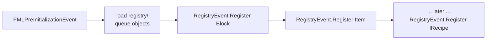

# Block and item registry events

Registry scripts only queue Java objects. This page explains when and how those
objects enter the Forge registries.

## Where the events sit in the lifecycle

In Forge 1.12.2, `Loader.preinitializeMods()` does the following after every
mod's `FMLPreInitializationEvent` handler has run:

```java
GameData.fireCreateRegistryEvents();
modController.distributeStateMessage(LoaderState.PREINITIALIZATION, ...);
GameData.fireRegistryEvents(rl -> !rl.equals(GameData.RECIPES));
FMLCommonHandler.instance().fireSidedRegistryEvents();
```

The filter is important: **all registry events except recipes fire during
pre-initialization**. The recipe event is deferred until
`Loader.initializeMods()` (see
[Recipe registration](/docs/internals/mod-init/recipe-registration)).

For MoonTweaker this means:



## `RegistryHandler`

`RegistryHandler` is registered on `MinecraftForge.EVENT_BUS` during pre-init.
It subscribes to two events:

```java
public class RegistryHandler {
    @SubscribeEvent
    public void onRegisterBlocks(RegistryEvent.Register<Block> event) {
        List<Block> blocks = RegistryApi.pendingBlocks();
        for (Block block : blocks) {
            event.getRegistry().register(block);
        }
        if (!blocks.isEmpty()) {
            logger.info("MoonTweaker: registered {} blocks", blocks.size());
        }
    }

    @SubscribeEvent
    public void onRegisterItems(RegistryEvent.Register<Item> event) {
        List<Item> items = RegistryApi.pendingItems();
        for (Item item : items) {
            event.getRegistry().register(item);
        }
        if (!items.isEmpty()) {
            logger.info("MoonTweaker: registered {} items", items.size());
        }
    }
}
```

No priority is specified, so both handlers use Forge's default priority
(`NORMAL`). Forge fires the block event before the item event, so the order is
deterministic.

## What is in the pending lists

`RegistryApi` keeps module-level lists:

```java
private static final List<Item> items = new ArrayList<>();
private static final List<Block> blocks = new ArrayList<>();
```

The lists contain more than plain items:

| Pending item | Created by | Registered at |
|---|---|---|
| Plain `Item` | `registry.item` / `registry.material` | Item event |
| `ItemBlock` | `registry.block` | Item event |
| `ItemPickaxe`, `ItemAxe`, `ItemSpade`, `ItemSword`, `ItemHoe` | `registry.tool` | Item event |
| `ItemArmor` × 4 | `registry.armor` | Item event |
| `ItemBucket` | `registry.fluid` | Item event |
| `Block` | `registry.block` | Block event |
| `BlockFluidClassic` | `registry.fluid` | Block event |

The fluid itself is not in either list: `FluidRegistry.registerFluid(fluid)`
runs immediately during the registry stage, and
`FluidRegistry.addBucketForFluid(fluid)` associates the bucket.

## Registration order inside `registry.block`

```java
ResourceLocation id = id(name);
Block block = new Block(blockMaterial(opts.get("material").optjstring("rock")));
block.setRegistryName(id);
block.setTranslationKey(id.getPath());
block.setHardness(...);
block.setResistance(...);
blocks.add(block);

ItemBlock itemBlock = new ItemBlock(block);
itemBlock.setRegistryName(id);
itemBlock.setCreativeTab(CreativeTabs.BUILDING_BLOCKS);
items.add(itemBlock);
```

Both the block and its `ItemBlock` use the **same** `ResourceLocation`. This is
valid because they live in different registries (`BLOCKS` and `ITEMS`). The
Lua-side duplicate check, however, is shared: calling `registry.block("foo")`
twice raises `duplicate id`.

## Tool and armor materials

Materials are created while the script runs, not during the registry event:

```java
Item.ToolMaterial material = toolMaterials.computeIfAbsent(key, k -> {
    return EnumHelper.addToolMaterial(
        enumName("tool", name),
        opts.get("level").optint(1),
        opts.get("durability").optint(180),
        (float) opts.get("efficiency").optdouble(4.0),
        (float) opts.get("damage").optdouble(1.0),
        opts.get("enchantability").optint(10)
    );
});
```

Consequences:

- The **first** call for a material name defines its stats. Later tools with
  the same material reuse the material and ignore their options.
- Enum names are sanitized:
  `<namespace>_<kind>_<name>` uppercased, with every non `[A-Z0-9_]` character
  replaced by `_`.
- Armor uses `SoundEvents.ITEM_ARMOR_EQUIP_GENERIC`, render index `0`, and the
  texture base `<namespace>_<material>`.

## Failure modes

| Situation | Result |
|---|---|
| Script throws before queuing | Nothing is queued; error recorded |
| Script throws after queuing some objects | Already-queued objects are still registered |
| Duplicate Lua id | `duplicate id '<id>'`, current file aborts |
| Forge registry already frozen | Not possible in the normal flow; registry stage only runs at pre-init |
| Missing model/blockstate | Content exists server-side; client shows missing texture |

Because registration is one-shot, a restart is mandatory after editing
`registry/`. `/moontweaker reload` does not touch this stage.

## Logs

Successful registration logs:

```text
MoonTweaker: registered 3 blocks
MoonTweaker: registered 8 items
```

The counts are the sizes of the pending lists at the moment the event fires.
They are not repeated on reload, because the handlers only fire once per game
start.

## What comes next

After the item event, Forge continues initialization. Recipes are registered
much later, during `Loader.initializeMods()`. That is where `server/` scripts
run. Continue with
[Recipe registration](/docs/internals/mod-init/recipe-registration).
