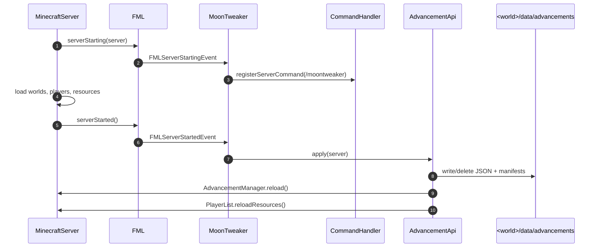

# Server lifecycle

Mod loading ends with `GameData.freezeData()`, but MoonTweaker still has work to
do once a world exists. Two Forge server events matter:

| Event | MoonTweaker handler | Why |
|---|---|---|
| `FMLServerStartingEvent` | register `/moontweaker` | Commands must exist before players can use them |
| `FMLServerStartedEvent` | `AdvancementApi.apply(server, LOGGER)` | Advancements live in the world save and need a live `MinecraftServer` |



## `FMLServerStartingEvent`

```java
@Mod.EventHandler
public void serverStarting(FMLServerStartingEvent event) {
    event.registerServerCommand(new MoonTweakerCommand(SCRIPTS));
}
```

The handler is intentionally tiny. The `ScriptManager` is the same instance
created at mod construction, so the command sees the live error list and the
same stage state.

### The command

```text
/moontweaker <reload|errors|dump>
/mt <reload|errors|dump>
```

| Subcommand | Effect |
|---|---|
| `reload` | Clears errors and counters, re-runs `server/`, applies advancements |
| `errors` | Prints every recorded script error as `file: message` |
| `dump <type> [limit]` | Prints registry contents to chat |

`dump` types: `items`, `blocks`, `fluids`, `recipes`, `ores`, `registry`.
The default limit is 50. `registry` is the only dump that shows MoonTweaker's
own pending lists rather than a Forge registry.

`checkPermission` always returns `true`. There is no permission node; on a
public server, restrict the command with a permissions plugin if ordinary
players should not see registry dumps or trigger reloads.

### Reload also applies advancements

```java
case "reload":
    scripts.reload();
    AdvancementApi.apply(server, MoonTweaker.LOGGER);
    ...
```

Unlike machine recipes, advancements **can** be re-applied after a reload
because their state is written to disk and loaded by `AdvancementManager`.
`/moontweaker reload` therefore updates custom advancements and tombstones
immediately. Recipe and registry changes still need a restart.

## `FMLServerStartedEvent`

```java
@Mod.EventHandler
public void serverStarted(FMLServerStartedEvent event) {
    AdvancementApi.apply(
        FMLCommonHandler.instance().getMinecraftServerInstance(),
        LOGGER
    );
}
```

`getMinecraftServerInstance()` returns the running dedicated or integrated
server. On a client playing single-player, this is the integrated server; the
handler runs every time a world is opened.

### Why advancements need the server

An advancement is not a Forge registry entry. It is loaded by
`AdvancementManager` from:

```text
<world>/data/advancements/<namespace>/<path>.json
```

The world directory only exists once a server has been constructed:

```java
File worldDir = server.worlds[0].getSaveHandler().getWorldDirectory();
File advDir = new File(new File(worldDir, "data"), "advancements");
```

`server.worlds[0]` is the overworld. The advancement manager itself is reached
through:

```java
server.getAdvancementManager()
// == server.worlds[0].getAdvancementManager()
```

### Thread safety

```java
public static void apply(MinecraftServer server, Logger logger) {
    Runnable task = () -> applyNow(server, logger);
    if (server.isCallingFromMinecraftThread()) {
        task.run();
    } else {
        server.addScheduledTask(task);
    }
}
```

The handler normally runs on the server thread, so `applyNow` executes inline.
If another caller (for example a future API) invokes it off-thread, the work is
scheduled onto the server thread instead of touching the world from the wrong
thread.

### What `applyNow` does

1. Read `.moontweaker` and `.moontweaker-vanilla` manifests from the world.
2. Merge `startupPending` and `pending`; server definitions win on duplicate
   IDs.
3. Merge removals; remove those IDs from the pending map.
4. Warn about parents that are neither pending nor already loaded.
5. Resolve vanilla targets: explicit removals, whole trees, or every
   `minecraft:*` advancement.
6. Delete files for removed custom IDs and stale IDs from the previous
   manifest.
7. Write changed custom advancement JSON files.
8. Write tombstones for vanilla targets that are not replaced by a custom
   definition.
9. Rewrite both manifests.
10. If anything changed, call `AdvancementManager.reload()` and
    `PlayerList.reloadResources()`.

The write step compares bytes first:

```java
if (file.isFile() && Arrays.equals(Files.readAllBytes(file.toPath()), bytes)) {
    return false;
}
```

Unchanged files are not rewritten, so a restart with no script changes does not
touch the disk.

### Tombstones

A tombstone is a valid advancement file with the **same ID** as the original:

```json
{
  "parent": "minecraft:story/root",
  "criteria": {
    "moontweaker_removed": {
      "trigger": "minecraft:impossible"
    }
  }
}
```

Because it has no `display` and an impossible criterion, it replaces the
original in `AdvancementManager`, cannot complete, and does not appear in the
advancement GUI. Keeping the original `parent` prevents the removed node from
becoming an invisible root and keeps visible descendants attached to the
nearest visible ancestor.

Custom definitions are written after tombstones and win: `collectVanillaTargets`
removes every pending ID from the target set.

### Resyncing players

`AdvancementManager.reload()` rebuilds the server-side tree. It does not by
itself tell already-connected clients about the new tree or rebuild their
criterion listeners. MoonTweaker therefore calls:

```java
server.getPlayerList().reloadResources();
```

which invokes `PlayerAdvancements.reload()` for every online player. Without
this, `/moontweaker reload` would update the server but clients would keep the
old advancement screen until they reconnect.

### When nothing happens

`applyNow` only reloads the manager when at least one of these is true:

- A file was written or deleted.
- The previous custom manifest was non-empty.
- The previous vanilla manifest was non-empty.

A pack with no advancement definitions and no tombstones does no disk I/O and
logs nothing. This is the common case for recipe-only packs.

### Logs

```text
MoonTweaker: applied 4 custom advancements and hid 12 existing advancements
MoonTweaker: advancement 'mypack:quest2' references missing parent 'mypack:quest1'
MoonTweaker: cannot remove advancement 'minecraft:nope': it does not exist
MoonTweaker: failed to apply advancements: <exception>
```

A missing parent is a warning, not an error. Vanilla loads the advancement but
it may not appear where you expect.

## World switches in single-player

Because `FMLServerStartedEvent` fires for each world open, advancements are
applied to whichever world is loaded. The Lua-side state, however, is global
and was built at startup:

- `startupPending` and its removal sets persist for the process lifetime.
- `pending` reflects the last `server/` load or reload.
- Nothing is keyed by world.

Opening world A, quitting, and opening world B therefore writes the same
definitions into both worlds. Each world keeps its own JSON files and
manifests.

## Server stopping

MoonTweaker does not subscribe to `FMLServerStoppingEvent` or
`FMLServerStoppedEvent`. There is no per-world cleanup:

- Pending advancement definitions stay in memory.
- Event listeners stay registered.
- Loot operations stay queued.
- The `ScriptManager` error list stays as-is.

This is harmless for a normal shutdown. It matters only if the same JVM runs
another server (integrated server world switch): state from the previous world
is reused.

## What comes next

Once the server is running, MoonTweaker reacts to loot table loads, gameplay
events and server ticks. Continue with
[Runtime](/docs/internals/mod-init/runtime).
