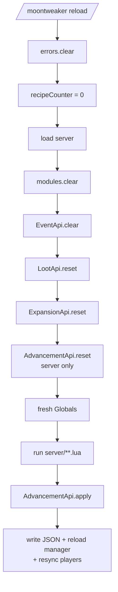
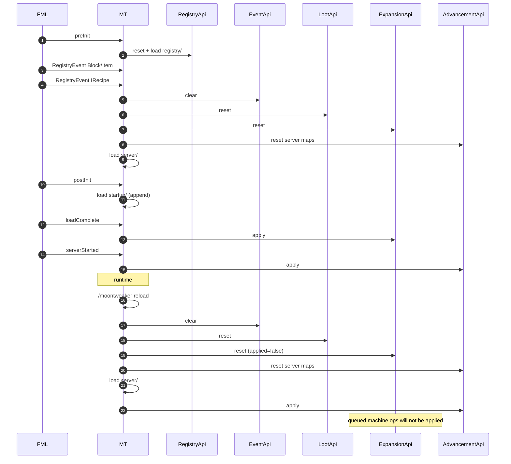

# State, resets and reload

MoonTweaker keeps most of its state in Java `static` fields, not in Lua. This
page lists every piece of state, when it is reset, and what survives a reload.

## The stage loader

Every stage goes through `ScriptManager.load(stage)`:

```java
private void load(String stage) {
    modules.clear();
    MoonTweakerApi.currentStage = stage;
    switch (stage) {
        case "registry":
            RegistryApi.reset();
            break;
        case "server":
            EventApi.clear();
            LootApi.reset();
            ExpansionApi.reset();
            AdvancementApi.reset();
            break;
    }
    File dir = new File(scriptDir(), stage);
    if (!dir.isDirectory()) {
        dir.mkdirs();
        return;
    }
    Globals globals = createGlobals();
    int count = 0;
    List<File> files = new ArrayList<>();
    collectLuaFiles(dir, files);
    files.sort(Comparator.comparing(File::getPath));
    for (File file : files) {
        if (runFile(globals, file, dir)) count++;
    }
    loadedCount = count;
    logger.info("MoonTweaker: stage '{}' loaded, {} scripts, {} errors",
        stage, count, errors.size());
}
```

Four facts follow from this code:

1. **The module cache is always cleared**, for every stage.
2. **`startup` has no reset block.** It appends to whatever `server` left.
3. **Errors are not cleared here.** They accumulate across `registry`,
   `server` and `startup` until `reload()` or a restart.
4. **A missing stage folder returns early** after creating it. No globals are
   built, no log line is written, and `loadedCount` is not updated.

## Reset matrix

| State | `registry/` load | `server/` load | `startup/` load | `/moontweaker reload` |
|---|---|---|---|---|
| `require` module cache | Cleared | Cleared | Cleared | Cleared |
| `currentStage` | `registry` | `server` | `startup` | `server` |
| `RegistryApi.namespace` | `moontweaker` | — | — | — |
| `RegistryApi` pending items/blocks | Cleared | — | — | — |
| Tool/armor material maps | Cleared | — | — | — |
| `EventApi` listeners | — | **Cleared** | — | **Cleared**, then re-registered by `server/` |
| `LootApi` operations | — | **Cleared** | — | **Cleared**, then re-queued by `server/` |
| Loot pool counter | — | Reset | — | Reset |
| `ExpansionApi` operations | — | **Cleared** | — | **Cleared** |
| `ExpansionApi.applied` | — | **`false`** | — | **`false`** |
| `AdvancementApi` server pending/removals | — | **Cleared** | — | **Cleared** |
| `AdvancementApi` startup pending/removals | — | — | — | **Preserved** |
| Recipe counter | — | — | — | Reset to 0 |
| `loadedCount` | Set | Set | Set | Set to server count |
| Error list | Appends | Appends | Appends | **Cleared** |
| Forge registries | Open | Recipe registry open | Frozen | Frozen |

`—` means the field is not touched by that stage.

### Why `registry/` resets content

`RegistryApi.reset()` is called at the start of the registry stage so a fresh
game start cannot inherit objects from a previous load in the same JVM. It
resets:

```java
namespace = DEFAULT_NAMESPACE;   // "moontweaker"
usedIds.clear();
items.clear();
blocks.clear();
toolMaterials.clear();
armorMaterials.clear();
```

`/moontweaker reload` does **not** call this reset, because it never loads the
registry stage. The pending lists therefore still contain the startup content
after the server is running. This is what `/moontweaker dump registry` prints.

### Why `startup/` has no reset

`server/` runs first and owns the "base" state for runtime queues. `startup/`
adds to it deliberately:

- A listener registered in `server/` and one registered in `startup/` both
  exist.
- Loot operations from both stages are applied in the order they were queued.
- Machine operations from both stages are applied at load complete.

Advancements are the exception. They use separate startup maps so that a
reload, which re-runs only `server/`, does not delete definitions that only
exist in `startup/`.

## What `/moontweaker reload` does

```java
public void reload() {
    errors.clear();
    recipeCounter = 0;
    loadedCount = 0;
    loadServer();
}
```

Step by step:

1. Clear every recorded script error.
2. Reset the shaped/shapeless recipe ID counter.
3. Reset the loaded-file counter.
4. Call `load("server")`, which:
   - clears the module cache,
   - sets `currentStage = "server"`,
   - clears event listeners,
   - clears and resets loot operations and the pool counter,
   - clears machine operations and sets `applied = false`,
   - clears server advancement definitions and removals (startup ones stay),
   - creates a fresh `Globals`,
   - runs every `server/**.lua` file in sorted order.

The command handler then calls `AdvancementApi.apply(server, LOGGER)`, so
advancement changes are written and synced immediately.



## What survives a reload

| Resource | Survives? | Notes |
|---|---|---|
| `registry/` queued objects | Yes, in memory | Forge registries are frozen; they cannot be re-registered |
| `startup/` Lua definitions | No (code does not re-run) | But their Java-side advancement state survives |
| `startup/` event listeners | No | Cleared by `EventApi.clear()` |
| `startup/` loot operations | No | Cleared by `LootApi.reset()` |
| `startup/` machine operations | No | Cleared by `ExpansionApi.reset()` |
| `startup/` advancement definitions | **Yes** | Stored in `startupPending` and friends |
| `startup/` advancement removals | **Yes** | Stored in `startupRemovals`, `startupVanillaRemovals`, ... |
| `server/` advancement definitions | Rebuilt | Cleared then re-queued by the reload |
| Existing recipes | Yes | Registry frozen |
| Existing machine recipes | Yes | They live inside the other mod's manager |
| World advancement files | Yes | Rewritten only when the definition changes |

## Silent no-ops after a reload

These are the cases where a reload succeeds but the change does not take
effect. They are worth knowing because no error is printed.

### Machine recipes

`ExpansionApi.reset()` clears `ops` and sets `applied = false`. Server scripts
can then queue machine recipes again without hitting the "restart the game"
guard. But `ExpansionApi.apply()` is only called from
`FMLLoadCompleteEvent`, which does not fire again. The queued operations are
never applied.

**Rule:** machine recipes require a restart.

### Loot from `startup/`

`LootApi.reset()` clears the entire queue, including operations queued by
`startup/`. Only `server/` re-queues. A pack that defines all loot in
`startup/` loses those operations after `/moontweaker reload` until the next
restart.

**Rule:** put loot in `server/` if you want it to survive reload, or accept
that reload drops startup loot until restart.

### Events from `startup/`

`EventApi.clear()` removes every listener, including startup listeners.
`startup/` does not re-run, so those callbacks stop working until restart.

**Rule:** register event listeners in `server/` unless the listener must exist
before server scripts and you never use `/moontweaker reload`.

### Recipes

`recipes.shaped` and `recipes.shapeless` throw after the registry is frozen.
`recipes.remove` cannot find recipes to remove, or the removal fails. The
reload reports these as script errors.

**Rule:** recipe changes require a restart.

### Registry content

`registry.*` is not available in `server/` at all; the restricted table throws.
Even if it were available, the Forge registries are frozen. Content changes
require a restart.

## Errors and diagnostics

`ScriptManager.errors` is a `CopyOnWriteArrayList<ScriptError>`:

```java
public static class ScriptError {
    public final String file;
    public final String message;
}
```

- Added by `runFile` when a file throws `LuaError` or any other `Throwable`.
- The file name is relative to the stage root and prefixed with `@` in the Lua
  chunk name; the stored value strips the `@`.
- Not cleared between `registry`, `server` and `startup` loads.
- Cleared by `reload()`.
- Printed by `/moontweaker errors`.

Consequences:

- A startup error is visible after startup, but disappears from
  `/moontweaker errors` after a reload even though the startup code is still
  active. The per-file message was never written to the server log; only the
  stage summary count remains there.
- Runtime errors from event callbacks are **not** added to this list. They are
  logged as `MoonTweaker: error in event '<name>': ...` and are invisible to
  `/moontweaker errors`.
- Errors from machine recipe application are logged and counted as failures;
  they are not script errors.

## `/reload` versus `/moontweaker reload`

| Command | What it reloads |
|---|---|
| `/moontweaker reload` | `server/` Lua scripts, event/loot/machine queues, advancements |
| `/reload` | Minecraft server resources: loot tables, functions, advancements from disk, recipes for the recipe book |
| Restart | Everything, including `registry/` and `startup/`, Forge registries and machine recipe managers |

A typical loot workflow needs both:

```text
/moontweaker reload
/reload
```

The first rebuilds the Lua-side queue; the second makes tables load again so
`LootTableLoadEvent` applies the queue.

## Complete startup-to-reload timeline



## Restart checklist

Use a full restart when you change:

- anything in `registry/`;
- anything in `startup/` that registers events, loot or machine recipes;
- machine recipes in any stage;
- recipe additions or removals;
- mods in the instance.

Use `/moontweaker reload` when you change:

- recipes in `server/` **only if** you understand that the registry is frozen
  (in practice: restart);
- loot in `server/` (follow with `/reload`);
- event listeners in `server/`;
- advancement definitions in `server/` or `startup/`.

## Next steps

This completes the mod initialization section. From here you can read the
[Script engine](/docs/internals/script-engine/) for the Lua-side details, or go
straight to the [API reference](/docs/api/data-types).
