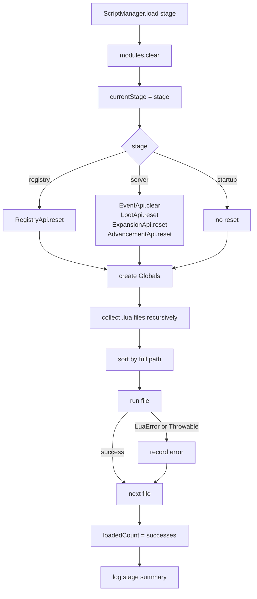

# Script engine overview

MoonTweaker embeds **LuaJ 3.0.1**, a Lua 5.2 implementation for the JVM. Every
script is plain Lua; there is no preprocessor, no TypeScript-like layer and no
generated Java.

## Execution model



Key properties:

- **One `Globals` per stage load.** Files in the same stage share globals;
  different stages do not.
- **No shared Lua state between stages.** A global set in `server/` is not
  visible in `startup/`. Communication happens through Java-side queues.
- **A fresh `Globals` on reload.** Old globals become unreachable once listeners
  are cleared.
- **Errors are per file.** A failing file does not stop the stage.

## Lua version and libraries

LuaJ is configured with:

```java
Globals g = new Globals();
g.load(new BaseLib());
g.load(new PackageLib());
g.load(new Bit32Lib());
g.load(new TableLib());
g.load(new StringLib());
g.load(new CoroutineLib());
g.load(new JseMathLib());
LoadState.install(g);
LuaC.install(g);
```

| Library | Status | Notes |
|---|---|---|
| Base | Loaded | `assert`, `error`, `pcall`, `xpcall`, `pairs`, `ipairs`, `next`, `select`, `tonumber`, `tostring`, `type`, `rawequal`, `rawget`, `rawset`, `setmetatable`, `getmetatable`, `_G` |
| `package` | Loaded, then removed | The global is set to `nil` |
| `bit32` | Loaded | Bitwise operations |
| `table` | Loaded | `insert`, `remove`, `sort`, `concat`, `unpack`, ... |
| `string` | Loaded | Lua patterns, `format`, `gsub`, ... |
| `coroutine` | Loaded | Create/resume/yield, but MoonTweaker never schedules them |
| `math` | Loaded | `JseMathLib`, backed by `java.lang.Math` |
| `os` | Replaced | Only `time`, `clock`, `difftime` |
| `io` | Removed | Global set to `nil` |
| `luajava` | Removed | Never loaded; global set to `nil` |
| `debug` | Removed | Global set to `nil` |
| `dofile`, `loadfile`, `load` | Removed | Globals set to `nil` |

`LoadState` and `LuaC` install the binary chunk loader and compiler. They are
needed for `Globals.load(String, String)` to compile source text.

See [Sandbox and modules](/docs/internals/script-engine/sandbox-and-modules)
for the exact restrictions and `require` semantics.

## File discovery

```java
private void collectLuaFiles(File dir, List<File> out) {
    File[] children = dir.listFiles();
    if (children == null) return;
    for (File child : children) {
        if (child.isFile() && child.getName().endsWith(".lua")) {
            out.add(child);
        } else if (child.isDirectory()) {
            collectLuaFiles(child, out);
        }
    }
}

files.sort(Comparator.comparing(File::getPath));
```

Rules:

- Only regular files ending in `.lua` (case-sensitive).
- Recursion into every subdirectory, in filesystem order, then sorted.
- Sort key is the **absolute path string**, not the relative path. Since all
  files share the same stage root, the practical effect is the same as sorting
  relative paths.
- Hidden directories are not skipped.
- Symlinks are followed by `File.isDirectory()`/`isFile()`; a symlink loop
  could recurse indefinitely.

Example order:

```text
server/a.lua
server/config/balance.lua
server/recipes/tools.lua
server/z.lua
```

Because `/` sorts before letters and `.` sorts before most characters, nested
folders are not necessarily loaded after top-level files. The path string is
the only ordering rule.

## Running a file

```java
private boolean runFile(Globals globals, File file, File root) {
    String name = "@" + root.toPath().relativize(file.toPath()).toString().replace('\\', '/');
    try {
        globals.load(readFile(file), name).call();
        return true;
    } catch (LuaError e) {
        errors.add(new ScriptError(name.substring(1), ...));
        return false;
    } catch (Throwable e) {
        errors.add(new ScriptError(name.substring(1), e.toString()));
        return false;
    }
}
```

- Files are read as UTF-8.
- The chunk name is `@<relative-path>`, which makes Lua errors report
  `file.lua:line: message`.
- Each file is compiled and executed immediately; there is no shared top-level
  chunk.
- `return` at file scope is allowed but its value is discarded (except inside
  `require`).

### What counts as success

A file is counted in `loadedCount` only if `load(...).call()` returns without
throwing. A file that queues half its content and then throws is **not**
counted, but its earlier side effects remain.

## The stage API switch

Each stage installs the same API names, but some are gated:

| API | `registry/` | `server/` | `startup/` |
|---|---|---|---|
| `registry` | Real table | Restricted table | Restricted table |
| `moonexpansion` | Throws on call | Queues | Queues |
| `recipes` | Installed | Installed | Installed, but registry frozen |
| `loot` | Installed, later discarded | Installed | Installed, appended |
| `events` | Installed, later cleared | Installed | Installed, appended |
| `advancement` | Installed, later discarded | Installed | Installed, separate maps |

`RegistryApi.install(g)` checks `currentStage` **at globals creation time**:

```java
if (!"registry".equals(MoonTweakerApi.currentStage)) {
    g.set("registry", restricted());
    return;
}
```

`ExpansionApi` checks `currentStage` **at call time**. This matters only if code
stores the API table and calls it later, which cannot happen across stages
because globals are per stage.

## Error model

| Error source | Recorded in `/moontweaker errors` | Logged |
|---|---|---|
| Compile error in a stage file | Yes | Stage summary only |
| Runtime `LuaError` in a stage file | Yes | Stage summary only |
| Java `Throwable` in a stage file | Yes | Stage summary only |
| Error in an event callback | No | Yes, per event |
| Error applying a loot operation | No | Yes, per table |
| Error applying a machine recipe | No | Yes, per recipe |
| Error applying advancements | No | Yes, one line |

The stage summary reports the total count, but not the messages:

```text
MoonTweaker: stage 'server' loaded, 3 scripts, 1 errors
```

Run `/moontweaker errors` for the file and message.

## Global state and closures

Lua functions stored in Java-side structures keep their defining `Globals`
alive:

- `EventApi.listeners` stores `LuaValue` functions.
- Machine recipe `Op`s store Java `Runnable`s that captured Java objects, not
  Lua closures.
- Loot operations store Java values only.
- Advancement definitions are converted to Gson `JsonObject`s immediately.

On reload, `EventApi.clear()` drops all Lua function references, so the old
`Globals` can be garbage-collected. There is no cross-stage function sharing.

## What comes next

- [Sandbox and modules](/docs/internals/script-engine/sandbox-and-modules) —
  exactly what Lua can and cannot do.
- [Reload](/docs/internals/script-engine/reload) — the Lua-side view of
  `/moontweaker reload`.
- [Mod initialization](/docs/internals/mod-init/) — when each stage runs inside
  Forge.
