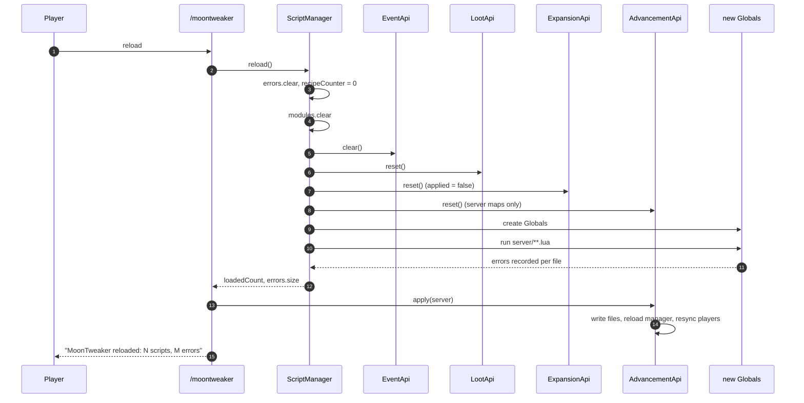

# Reload

`/moontweaker reload` is a **partial** reload: it re-runs only
`lua_scripts/server/`. It is designed for iterating on recipes, loot, events and
advancements without restarting the game. It is not a general hot-reload.

## The command

```java
case "reload":
    scripts.reload();
    AdvancementApi.apply(server, MoonTweaker.LOGGER);
    sender.sendMessage(new TextComponentString(
        "MoonTweaker reloaded: " + scripts.getLoadedCount()
        + " scripts, " + scripts.errors.size() + " errors"
    ));
    if (!scripts.errors.isEmpty()) {
        sender.sendMessage(new TextComponentString(
            "Run /moontweaker errors for details"
        ));
    }
    break;
```

```java
public void reload() {
    errors.clear();
    recipeCounter = 0;
    loadedCount = 0;
    loadServer();
}
```

## What is replaced

### Lua globals

`load("server")` builds a brand-new `Globals`:

- All globals defined by the previous `server/` run are gone.
- All modules cached by `require` are gone.
- All closures created by the previous run are unreachable **if** nothing
  still references them.

The exception is references held outside Lua:

| Holder | What it holds | Cleared? |
|---|---|---|
| `EventApi.listeners` | Lua functions | Yes, by `EventApi.clear()` |
| Loot queue | Java `Item`, integers, strings | Yes, by `LootApi.reset()` |
| Machine queue | Java `Runnable`s capturing Java objects | Yes, by `ExpansionApi.reset()` |
| Advancement queue | Gson `JsonObject`s | Server maps cleared; startup maps kept |

Because listeners are cleared before the new globals are created, the old
`Globals` normally becomes eligible for garbage collection after a reload.

### Module cache

```java
modules.clear();
```

Every `require` in the new `server/` run re-reads and re-executes its module
file. Modules from `startup/` are not cached either; the cache is global to
`ScriptManager`, not per stage, but it is cleared on every load.

### Error list

`errors.clear()` runs first. After a reload, `/moontweaker errors` shows only
errors from the new `server/` run. Errors from `registry/` and `startup/` are
gone from the command output (they remain in the log).

### Recipe counter

`recipeCounter = 0` resets the `moontweaker:script_<n>` sequence. This does not
make recipe registration work again: the Forge recipe registry is frozen.
Attempting to add a recipe produces an error, and if it somehow succeeded it
would collide with an existing name.

### Queues

| Queue | Effect |
|---|---|
| Event listeners | Cleared, then `server/` registers new ones |
| Loot operations | Cleared and pool counter reset, then `server/` re-queues |
| Machine operations | Cleared, `applied = false`, **no second apply** |
| Server advancements | Cleared, then `server/` re-queues |
| Startup advancements | Preserved |

## What is not replaced

- `RegistryApi` pending lists and namespace. The registry stage never runs
  again. `/moontweaker dump registry` still shows startup content.
- Forge registries: blocks, items, recipes and fluids are frozen.
- `startup/` scripts: they do not re-run.
- `startup/` event listeners, loot operations and machine operations: these are
  cleared but not re-created.
- Existing machine recipes inside Thermal Expansion, Ender IO or Immersive
  Engineering.
- World files on disk, except advancement files rewritten by `apply`.

## Reload sequence



## After the reload

### Loot needs `/reload`

The queue is rebuilt, but already-loaded loot tables are not mutated. Run:

```text
/moontweaker reload
/reload
```

`/reload` makes the server reload resources, which fires `LootTableLoadEvent`
for each table and applies the queue.

### Advancements apply immediately

The command calls `AdvancementApi.apply(server, LOGGER)` after the scripts run.
Custom advancements and tombstones are written, the manager reloads and online
players resync. No second command is needed.

### Machine recipes do not apply

`ExpansionApi.apply()` only runs from `FMLLoadCompleteEvent`. After a reload,
machine operations sit in the queue forever. Restart to change them.

### Recipes do not apply

The registry is frozen. Any `recipes.shaped` or `recipes.shapeless` call throws
and is recorded as a script error. `recipes.remove` cannot remove anything.
Restart to change recipes.

### Registry content does not apply

`registry` is a restricted table in `server/`. Every call throws:

```text
registry API is only available in lua_scripts/registry/
```

## Worked example

`lua_scripts/server/example.lua`:

```lua
log.info("reloading example")

loot.clear("minecraft:chests/simple_dungeon")
loot.add("minecraft:chests/simple_dungeon", {
  item = "minecraft:diamond",
  min = 1,
  max = 2,
  weight = 5,
})

events.on("block.break", function(e)
  if e.block == "minecraft:diamond_ore" then
    e:cancel()
  end
end)

advancement.add("mypack:root", {
  display = {
    icon = "minecraft:diamond",
    title = { text = "My Pack" },
    description = { text = "Reloaded" },
    background = "minecraft:textures/gui/advancements/backgrounds/stone.png",
  },
  criteria = {
    tick = { trigger = "minecraft:tick" },
  },
})
```

Sequence:

```text
/moontweaker reload
```

Expected chat:

```text
MoonTweaker reloaded: 1 scripts, 0 errors
```

Expected log:

```text
[Server thread/INFO] [moontweaker]: [lua] reloading example
MoonTweaker: stage 'server' loaded, 1 scripts, 0 errors
MoonTweaker: applied 1 custom advancements and hid 0 existing advancements
```

Then:

```text
/reload
```

The dungeon chest now uses the new pool, the diamond ore cannot be broken and
the advancement appears for players who qualify.

## Common mistakes

| Mistake | Symptom | Fix |
|---|---|---|
| Editing `startup/` then running reload | Nothing changes | Restart |
| Editing `registry/` then running reload | Nothing changes | Restart |
| Adding a recipe in `server/` then reloading | Script error about frozen registry | Restart |
| Expecting loot to change after only `/moontweaker reload` | Table unchanged | Run `/reload` too |
| Expecting machine recipes to change after reload | No error, no effect | Restart |
| Defining event listeners only in `startup/` | They work until the first reload, then stop | Move them to `server/` or restart after reload |
| Defining loot only in `startup/` | Works until the first reload, then disappears | Move it to `server/` or restart |
| A module was edited but `require` returns old data | Module cache cleared, so this should not happen; check that the file is under the current stage folder | Verify path and stage |

## Reload versus restart

| Change | Reload | Restart |
|---|---|---|
| `server/` recipe **removal** | Fails (frozen) | Yes |
| `server/` recipe **addition** | Fails (frozen) | Yes |
| `server/` loot | Yes, plus `/reload` | Yes |
| `server/` events | Yes | Yes |
| `server/` advancements | Yes | Yes |
| `startup/` anything | No | Yes |
| `registry/` anything | No | Yes |
| Machine recipes | No | Yes |
| New/removed mods | No | Yes |

If in doubt, restart. Reload is an optimization for a narrow set of changes.

## What comes next

The script engine section ends here. Continue with
[Internals](/docs/internals/architecture) for the Java architecture, or jump to
the [API reference](/docs/api/data-types).
