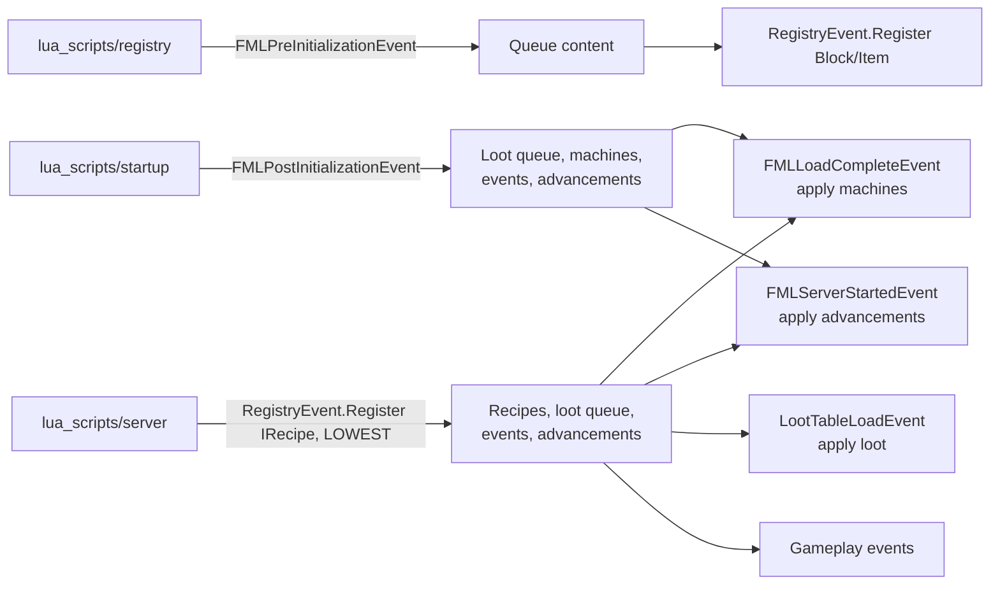

# MoonTweaker

**MoonTweaker** is an all-in-one, server-side Lua scripting mod for
**Minecraft 1.12.2 / Forge**, inspired by CraftTweaker and KubeJS. One jar
handles recipes, loot tables, content registration, machine recipes, gameplay
events and advancements. You do not need separate LunarLoot, MoonRegistry or
MoonExpansion jars.

```lua
-- lua_scripts/server/example.lua
recipes.remove("minecraft:stick")

recipes.shaped("minecraft:diamond_block",
  { "###", "###", "###" },
  { ["#"] = "minecraft:diamond" })

loot.add("minecraft:chests/simple_dungeon", {
  item = "minecraft:diamond", min = 1, max = 3, weight = 10,
})

events.on("block.break", function(e)
  if e.block == "minecraft:diamond_ore" then e:cancel() end
end)
```

## What it can do

| Area | Lua global | Capabilities |
|---|---|---|
| Crafting | `recipes` | Add shaped, shapeless and furnace recipes; remove registered crafting recipes |
| Loot | `loot` | Add weighted entries, remove item entries, clear whole tables |
| Content | `registry` | Register items, material items, blocks, tools, armor and fluids |
| Machines | `moonexpansion` | Add Thermal Expansion, Ender IO and Immersive Engineering recipes |
| Events | `events` | React to login, block break/place, entity death, item use and server ticks |
| Advancements | `advancement` | Define Triumph-style trees in Lua; hide single advancements, whole trees or all of vanilla |
| Utilities | `item`, `ore`, `log`, `print`, `require`, `os` | Item helpers, logging, modules and a restricted clock |

## Design principles

1. **Lua is the definition language.** Everything a content pack needs is a
   `.lua` file. There is no generated Java and no compile step.
2. **Run at the legal moment.** Forge registries are frozen at different times.
   MoonTweaker splits scripts into `registry/`, `server/` and `startup/` stages
   and runs each at the lifecycle point where its operations are allowed.
3. **Do not patch Minecraft.** There are no Mixins, no coremod and no
   transformed Minecraft classes. The mod uses Forge registries, Forge events
   and, only where Forge exposes no mutation API, narrow reflection.
4. **Fail per file, not per server.** A broken script is recorded, reported by
   `/moontweaker errors`, and the remaining scripts still run.
5. **Trusted scripts.** The sandbox removes filesystem, reflection and process
   APIs, but there is no instruction budget. An infinite loop still hangs the
   server.

## Requirements

| Component | Version |
|---|---|
| Minecraft | 1.12.2 |
| Forge | 14.23.5.2847 or newer |
| Java | 8 |
| Lua | 5.2 syntax (LuaJ 3.0.1, embedded) |

Optional integrations: Thermal Expansion, Ender IO and Immersive Engineering.
They are not compile-time dependencies; their recipe managers are called by
reflection at runtime.

## How a script gets from disk to the game



The full, source-level walkthrough is in
[Mod initialization](/docs/internals/mod-init/). If you only want to install
the mod and run your first script, start with
[Installation](/docs/getting-started/installation) and
[Quick start](/docs/getting-started/quick-start).

## Documentation map

- **Getting started** — install, first script, folder layout.
- **Mod initialization** — Forge lifecycle, class loading, every event and
  exactly what MoonTweaker does at each one.
- **Script engine** — stages, load order, sandbox, `require`, reload semantics.
- **Internals** — architecture, advancements, loot, registry and machine
  implementation details.
- **API reference** — every Lua function with types, defaults and errors.
- **Guides** — complete recipes for common tasks.
- **Reference** — errors, limitations, FAQ, logging, license.
- **Development** — build the jar, extend the API.

:::note Version
This site documents **MoonTweaker 0.1.0**. Behaviour described here reflects
`src/main/java/com/moontweaker/` at the time of writing.
:::
